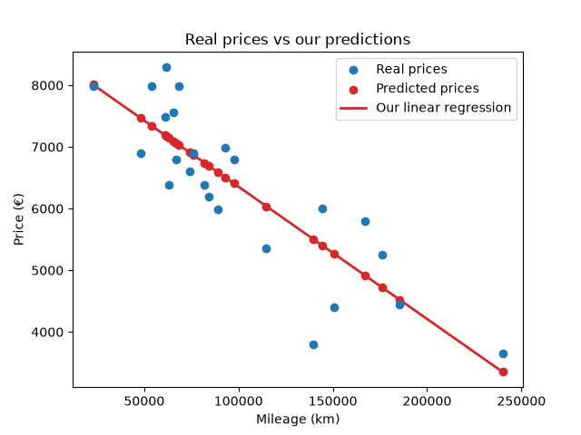
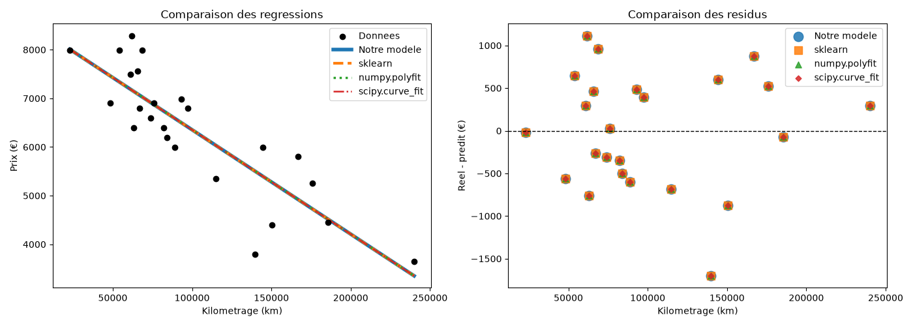

# ft_linear_regression

Implémentation pédagogique d'une régression linéaire simple par descente de
gradient afin d'estimer le prix d'un véhicule à partir de son kilométrage.

Le cœur du modèle est développé manuellement : calcul des prédictions, fonction
de coût, gradients, mise à jour simultanée des paramètres et métriques
d'évaluation. Les implémentations de scikit-learn, NumPy et SciPy sont utilisées
uniquement dans les programmes de comparaison et ne participent pas à
l'entraînement du modèle principal.



## Sommaire

- [Objectif](#objectif)
- [Données](#données)
- [Fonctionnement du modèle](#fonctionnement-du-modèle)
- [Évaluation](#évaluation)
- [Résultats](#résultats)
- [Architecture](#architecture)
- [Installation](#installation)
- [Utilisation](#utilisation)
- [Comparaison avec les bibliothèques](#comparaison-avec-les-bibliothèques)
- [Limites et pistes d'amélioration](#limites-et-pistes-damélioration)

## Objectif

Le projet répond à une problématique de régression supervisée : prédire une
variable numérique, le prix d'une voiture, à partir d'une variable explicative,
son kilométrage.

Il poursuit deux objectifs complémentaires :

1. comprendre les mécanismes mathématiques d'une régression linéaire en les
   implémentant sans modèle de machine learning préconstruit ;
2. vérifier la justesse de l'implémentation en la comparant à des références de
   l'écosystème scientifique Python.

Le pipeline couvre le chargement et la validation des données, l'entraînement,
la persistance des paramètres, la prédiction, la visualisation et l'évaluation.

## Données

Le fichier [`data/data.csv`](data/data.csv) contient 24 observations et deux
colonnes :

| Variable | Rôle | Unité |
|---|---|---|
| `km` | Variable explicative | kilomètres |
| `price` | Variable cible | euros |

Avant l'entraînement, le programme contrôle notamment la présence des colonnes,
les valeurs manquantes, les valeurs négatives et les jeux de données vides.

## Fonctionnement du modèle

### Hypothèse linéaire

Le modèle suppose que le prix peut être approximé par une fonction affine :

```text
ŷ = θ₀ + θ₁x
```

où `ŷ` est le prix prédit, `x` le kilométrage, `θ₀` l'ordonnée à l'origine et
`θ₁` la pente.

### Normalisation

Le kilométrage est normalisé par sa valeur maximale :

```text
x_normalisé = x / max(x)
```

Cette transformation ramène les entrées dans un intervalle proche de `[0, 1]`,
améliore la stabilité numérique et facilite la convergence de la descente de
gradient. La valeur maximale est sauvegardée avec le modèle afin d'appliquer
exactement la même transformation lors d'une future prédiction.

### Fonction de coût

L'entraînement minimise l'erreur quadratique :

```text
J(θ₀, θ₁) = (1 / 2m) × Σ(ŷᵢ - yᵢ)²
```

`m` représente le nombre d'observations. Le carré empêche les erreurs positives
et négatives de s'annuler et pénalise davantage les erreurs importantes. Le
facteur `1/2` simplifie la dérivation sans modifier la position du minimum.

### Descente de gradient

Les paramètres commencent à zéro, puis sont corrigés à chaque itération :

```text
θ₀ ← θ₀ - α × (1/m) × Σ(ŷᵢ - yᵢ)
θ₁ ← θ₁ - α × (1/m) × Σ((ŷᵢ - yᵢ) × xᵢ)
```

`α` est le taux d'apprentissage. L'implémentation utilise actuellement un taux
de `0,1` et `5 000` itérations. Les deux paramètres sont mis à jour
simultanément, condition importante pour appliquer correctement l'algorithme.

À la fin de l'entraînement, `θ₀`, `θ₁` et le kilométrage maximal sont enregistrés
dans [`model/parameters.json`](model/parameters.json).

## Évaluation

Une seule métrique ne suffit pas à décrire toutes les erreurs d'un modèle. Le
projet en utilise plusieurs, chacune répondant à une question différente.

| Métrique | Interprétation | Intérêt |
|---|---|---|
| MAE | erreur absolue moyenne en euros | mesure simple et directement interprétable |
| MSE | moyenne des erreurs au carré | pénalise fortement les grandes erreurs et correspond à l'objectif d'entraînement |
| RMSE | racine carrée de la MSE, en euros | conserve la sensibilité aux grandes erreurs dans l'unité de la cible |
| R² | part de la variance des prix expliquée | compare le modèle à une prédiction constante égale à la moyenne |
| Erreur absolue médiane | erreur centrale en euros | résiste mieux aux observations extrêmes |
| Erreur maximale | plus grande erreur observée | quantifie le pire cas sur l'échantillon |

### Baseline

Une baseline naïve prédit toujours le prix moyen, indépendamment du kilométrage.
Elle fournit un niveau de référence minimal : le modèle n'est utile que s'il
fait mieux que cette stratégie sans apprentissage.

### Résidus

Un résidu est la différence entre le prix observé et le prix prédit :

```text
résidu = prix réel - prix prédit
```

Un résidu positif correspond à une sous-estimation et un résidu négatif à une
surestimation. Leur graphique permet de détecter un biais, une structure non
linéaire, une variance non constante ou des observations atypiques qu'une
métrique agrégée pourrait masquer.

## Résultats

Sur le dataset fourni, le modèle obtient les résultats suivants :

| Indicateur | Résultat |
|---|---:|
| MAE | environ 557,84 € |
| Erreur absolue médiane | environ 511,65 € |
| RMSE | environ 667,57 € |
| Erreur maximale | environ 1 701,03 € |
| R² | environ 0,7330 |
| MAE de la baseline | environ 1 035,78 € |
| Amélioration de la MAE face à la baseline | environ 46,14 % |

Le R² indique qu'environ 73,3 % de la variabilité des prix de cet échantillon
est expliquée par la relation linéaire avec le kilométrage. Il ne signifie pas
que 73,3 % des prédictions sont « correctes ».

Ces résultats sont calculés sur les données d'entraînement. Ils décrivent donc
l'ajustement à l'échantillon disponible et non encore la performance sur des
véhicules totalement nouveaux.

## Architecture

```text
ft_linear_regression_init/
├── data/
│   └── data.csv                 # kilométrages et prix observés
├── model/
│   └── parameters.json          # paramètres entraînés et normalisation
├── notes/                       # documentation et notes d'apprentissage
├── notebooks/                   # travaux exploratoires
├── src/ft_linear_regression/
│   ├── train.py                 # descente de gradient et sauvegarde du modèle
│   ├── predict.py               # prédiction interactive
│   ├── visualisation.py         # données réelles et droite du modèle maison
│   ├── precision.py             # MAE, MSE, RMSE, R² et validation des formules
│   ├── SecondPrecision.py       # baseline, médiane, erreur max et résidus
│   ├── comparatif.py            # comparaison sklearn, NumPy et SciPy
│   └── utilseda.py              # outils d'analyse exploratoire
├── FIgure_comparatif.png
├── Resultat_bonus.png
├── pyproject.toml
└── README.md
```

## Installation

### Prérequis

- Python 3.12 ou supérieur ;
- [`uv`](https://docs.astral.sh/uv/) pour créer l'environnement et installer les
  dépendances.

Cloner le dépôt puis installer les dépendances principales et celles utilisées
pour les comparaisons :

```bash
git clone <URL_DU_DEPOT>
cd ft_linear_regression_init
uv sync --group school
```

Les dépendances principales sont pandas, NumPy et Matplotlib. Le groupe
`school` ajoute notamment scikit-learn et SciPy pour les programmes de
validation comparative.

## Utilisation

Toutes les commandes suivantes doivent être lancées depuis la racine du dépôt.

### 1. Entraîner le modèle

```bash
uv run python -m ft_linear_regression.train
```

Cette commande charge `data.csv`, exécute la descente de gradient et remplace
les paramètres présents dans `model/parameters.json`.

### 2. Prédire un prix

```bash
uv run --group school python -m ft_linear_regression.predict
```

Le programme demande un kilométrage puis affiche l'estimation du modèle maison.
Dans sa version comparative actuelle, il affiche également les estimations de
scikit-learn et de `numpy.polyfit` à titre de contrôle.

### 3. Visualiser le modèle maison

```bash
uv run python -m ft_linear_regression.visualisation
```

Le graphique montre uniquement les prix réels, les prix prédits et la droite
obtenue avec la descente de gradient développée dans le projet.

### 4. Calculer les métriques principales

```bash
uv run --group school python -m ft_linear_regression.precision
```

Ce programme calcule manuellement MAE, MSE, RMSE et R², puis confronte les
résultats à `sklearn.metrics` pour valider les formules.

### 5. Analyser la précision et les résidus

```bash
uv run --group school python -m ft_linear_regression.SecondPrecision
```

Pour obtenir seulement les résultats textuels :

```bash
uv run --group school python -m ft_linear_regression.SecondPrecision --no-plot
```

### 6. Comparer les implémentations

```bash
uv run --group school python -m ft_linear_regression.comparatif
```

Pour désactiver les graphiques :

```bash
uv run --group school python -m ft_linear_regression.comparatif --no-plot
```

## Comparaison avec les bibliothèques



Le modèle maison est comparé à :

- `sklearn.linear_model.LinearRegression` ;
- `numpy.polyfit` avec un polynôme de degré 1 ;
- `scipy.optimize.curve_fit` appliqué à une fonction affine.

Les quatre approches produisent des prédictions pratiquement identiques. Ce
résultat est attendu : elles minimisent toutes la même somme des erreurs au
carré sur les mêmes observations.

La fonction de coût d'une régression linéaire est convexe et possède un minimum
global unique. Les bibliothèques atteignent ce minimum avec des méthodes
d'algèbre linéaire ou d'optimisation spécialisées ; le modèle maison s'en
approche itérativement par descente de gradient. Après convergence, ils trouvent
donc la même droite, à de très faibles différences numériques près.

Les coefficients ne sont pas directement présentés à la même échelle : le
modèle maison apprend sur le kilométrage normalisé alors que les bibliothèques
travaillent sur le kilométrage brut. Les équations restent équivalentes :

```text
θ₀ + θ₁ × (km / km_max) = intercept + slope × km
slope = θ₁ / km_max
```

La superposition des courbes et des résidus constitue ainsi une validation
indépendante de l'implémentation manuelle, et non une utilisation cachée des
bibliothèques pendant son entraînement.

## Limites et pistes d'amélioration

- Le dataset ne contient que 24 observations : les estimations restent sensibles
  à chaque véhicule individuel.
- L'évaluation est réalisée sur les données d'entraînement. Une validation
  croisée ou un jeu de test indépendant serait nécessaire pour mesurer la
  généralisation.
- Le kilométrage n'explique pas à lui seul le prix d'un véhicule. L'année, la
  marque, le modèle, l'état, la motorisation ou l'historique d'entretien seraient
  des variables explicatives pertinentes.
- Une relation affine est volontairement simple. Une éventuelle non-linéarité
  devrait être vérifiée sur davantage de données avant de complexifier le modèle
  afin d'éviter le surapprentissage.
- Une future version pourrait automatiser les tests unitaires, la validation des
  données et la génération des rapports de performance dans une chaîne CI.

## Technologies

- Python 3.12+
- pandas
- Matplotlib
- NumPy
- scikit-learn et SciPy pour la validation comparative
- uv pour la gestion du projet et des dépendances

## Contexte

Ce projet a été réalisé dans un objectif pédagogique : comprendre ce que fait
une bibliothèque de machine learning derrière une API de haut niveau, puis
vérifier expérimentalement que l'implémentation manuelle converge vers la même
solution qu'une implémentation de référence.
